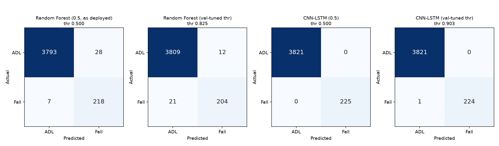
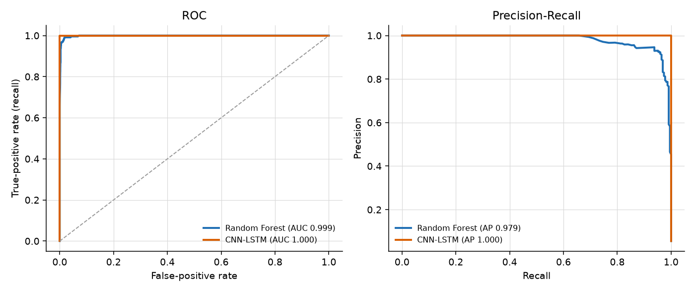
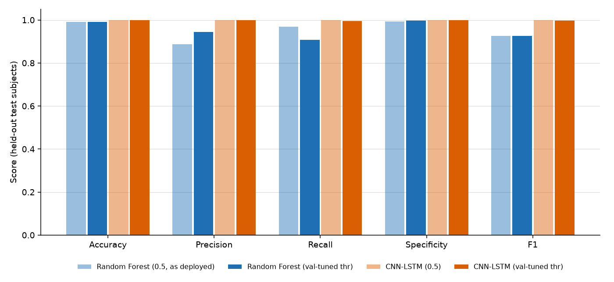

# Random Forest vs CNN-LSTM - evaluation report

> Real SisFall recordings, participant-independent held-out test subjects.

## Protocol

- Data source: **sisfall**; test subjects (6): SA18, SA16, SE11, SE02, SE04, SA05
- Test windows: 4046 (225 fall, 3821 ADL), 400 samples @ 200 Hz; identical windows for both models
- Split identical to the RF's 26/6/6 split (seed 42): **True**
- Fall windows: the tile containing the peak acceleration (SisFall has no sample-level fall labels) - an *estimated* event window, so labels carry some noise for both models
- CNN-LSTM trained on `sisfall` data, best epoch 4, channels ['adxl_x', 'adxl_y', 'adxl_z', 'gyro_x', 'gyro_y', 'gyro_z']
- RF artifact `fall_detection_rf.joblib` used read-only and unchanged
- Operating points: default 0.5 and F1-optimal threshold chosen on validation subjects (RF 0.825, CNN-LSTM 0.903)

## Results (held-out test subjects)

| Model / operating point | Acc | Prec | Recall | Spec | F1 | FPR | ROC-AUC | PR-AUC | False alarms/h | TP | FN | FP | TN |
|---|---|---|---|---|---|---|---|---|---|---|---|---|---|
| Random Forest (0.5, as deployed) | 0.991 | 0.886 | 0.969 | 0.993 | 0.926 | 0.007 | 0.999 | 0.979 | 13.2 | 218 | 7 | 28 | 3793 |
| Random Forest (val-tuned thr) | 0.992 | 0.944 | 0.907 | 0.997 | 0.925 | 0.003 | 0.999 | 0.979 | 5.7 | 204 | 21 | 12 | 3809 |
| CNN-LSTM (0.5) | 1.000 | 1.000 | 1.000 | 1.000 | 1.000 | 0.000 | 1.000 | 1.000 | 0.0 | 225 | 0 | 0 | 3821 |
| CNN-LSTM (val-tuned thr) | 1.000 | 1.000 | 0.996 | 1.000 | 0.998 | 0.000 | 1.000 | 1.000 | 0.0 | 224 | 1 | 0 | 3821 |

False alarms/hour = false-positive ADL windows per hour of laboratory ADL recording (contiguous 2 s tiles). Lab trials are not real-life wear time, so treat it as a relative number only.

## Cost

| Model | Size on disk | Complexity | Mean latency / window | p95 | Note |
|---|---|---|---|---|---|
| Random Forest | 7.05 MB | 200 trees, 85,198 nodes | 15.452 ms | 23.280 ms | features + predict_proba, n_jobs=1, 1 window |
| CNN-LSTM | 0.25 MB | 59,745 parameters | 0.891 ms | 1.072 ms | forward pass on normalised window, 1 window, PyTorch CPU |

## Which model performs better?

Comparing the RF as deployed with the CNN-LSTM at its validation-selected threshold, on 225 fall and 3821 ADL test windows:

- F1: 0.926 (RF) vs 0.998 (CNN-LSTM) -> CNN-LSTM
- Recall: 0.969 vs 0.996 -> CNN-LSTM
- Specificity: 0.993 vs 1.000 -> CNN-LSTM
- PR-AUC: 0.979 vs 1.000 -> CNN-LSTM
- False alarms/hour: 13.2 vs 0.0 -> CNN-LSTM

Caveats: only 6 test subjects (one subject can change recall noticeably), fall labels are estimated impact windows, there are no confidence intervals, and a single training seed was used. Differences of a few points are not evidence of a real difference. Any explanation for the gap (e.g. the CNN-LSTM seeing the raw waveform shape, versus the RF seeing only 8 window-level statistics; or the CNN-LSTM overfitting a small number of fall windows) is a hypothesis to test, not a finding. Repeat with several seeds and grouped cross-validation before any decision to promote a model.

## Integration status

The CNN-LSTM is a research model. It is not connected to the backend, emergency rules or caregiver notifications, and its predictions carry `alert_eligible: false`.
